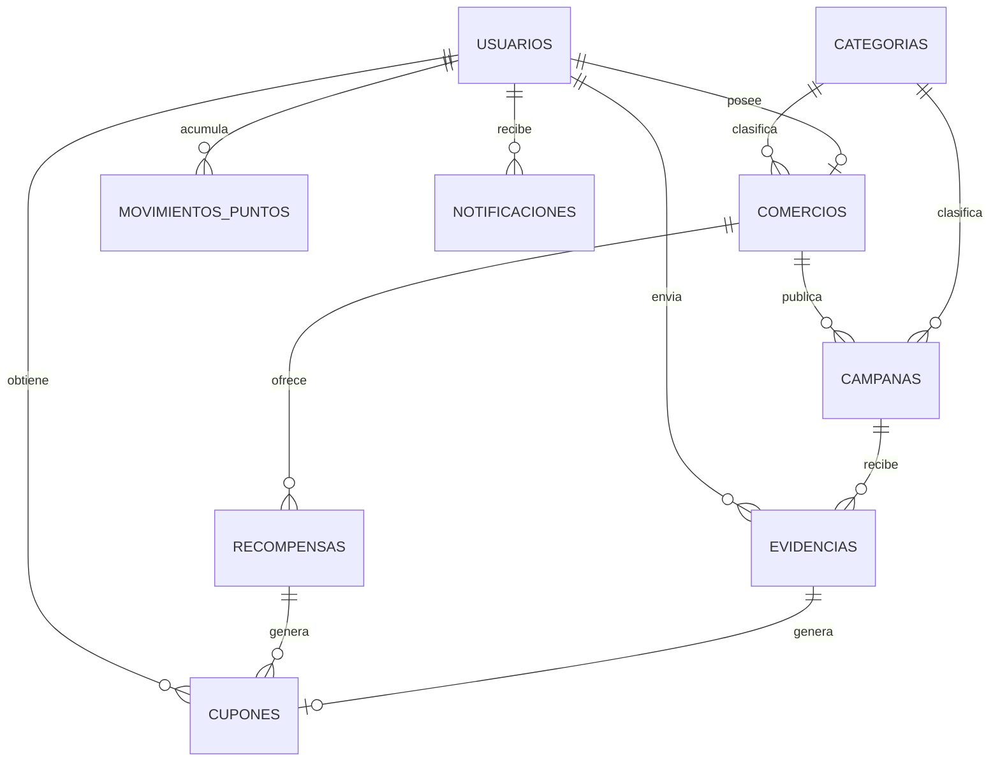

# Munchify — Plataforma de cupones y recompensas por interacción digital

Prototipo funcional del Proyecto de Graduación (Ingeniería en Computación, UTH).
Munchify conecta la promoción digital con recompensas reales: los comercios crean campañas,
los clientes realizan una acción en redes sociales, registran la evidencia y reciben un
cupón con código QR que se canjea en el establecimiento.

```
munchify/
├── backend/   API REST · Node.js + Express + MySQL
└── app/       App móvil · Flutter (Android / iOS / Web)
```

## Arquitectura

```
┌──────────────┐   HTTPS/JSON (JWT)   ┌───────────────────┐   SQL   ┌─────────┐
│  App Flutter │ ───────────────────▶ │ API Node/Express  │ ──────▶ │  MySQL  │
│ cliente /    │ ◀─────────────────── │  /api/...         │         └─────────┘
│ comercio     │   QR, capturas       │  uploads/ (fotos) │──▶ Firebase FCM (opcional)
└──────────────┘                      └───────────────────┘
```

## Módulos implementados (vs. la propuesta)

| Requisito de la propuesta | Implementación |
|---|---|
| Registro e inicio de sesión con roles | `POST /auth/registro`, `/auth/login` · roles `cliente`, `comercio`, `admin` · JWT |
| Crear promociones con condiciones, vigencia, cantidad y beneficio | Formulario de campaña (comercio) · `POST/PUT /campanas` |
| Registro de evidencias (captura, enlace) | Subida de imagen desde galería/cámara o enlace · `POST /campanas/:id/evidencias` |
| Validación de evidencias | Revisión manual (aprobar/rechazar con motivo) **o** validación automática por campaña |
| Cupón con código QR / código único, sin reutilización | Código `MCH-XXXX-XXXX` + QR · canje con bloqueo transaccional (`FOR UPDATE`) |
| Historial (promociones, cupones obtenidos, usados, vencidos) | Pantalla Historial con 3 pestañas · `GET /historial` |
| Panel de métricas del comercio | Participantes, emitidos, canjeados, tasa de canje, gráfico de 7 días, rendimiento por campaña |
| Sistema de puntos y recompensas | Puntos por participación · catálogo de recompensas · canje de puntos por cupón |
| Clasificación por categorías | Restaurantes, Cafeterías, Ropa, Calzado, Belleza, Entretenimiento |
| Notificaciones | Nuevas promociones, evidencia aprobada/rechazada, cupón canjeado, cupón por vencer/vencido. In-app + push FCM opcional |
| Integración con redes sujeta a APIs oficiales | Se usa evidencia y validación interna (según el alcance académico) |

## 1. Backend (API)

Requisitos: **Node.js 18+** y **MySQL 8** (o MariaDB 10.6+).

```bash
cd backend
npm install
cp .env.example .env        # en Windows: copy .env.example .env
# edita .env con tu usuario/contraseña de MySQL
npm run db:init             # crea la base "munchify" y sus tablas
npm run db:seed             # datos de demostración
npm start                   # http://localhost:3000/api
```

Prueba de extremo a extremo (con la API corriendo): `npm run test:smoke` → 30 verificaciones del flujo completo.

### Cuentas de demostración (contraseña `123456`)

| Rol | Correo |
|---|---|
| Comercio | burger@munchify.hn · cafe@munchify.hn · moda@munchify.hn |
| Cliente | ana@munchify.hn · luis@munchify.hn |

## 2. App Flutter

Requisitos: **Flutter 3.24+** (Dart 3.4+), Android Studio o VS Code.

```bash
cd app
bash configurar_plataformas.sh      # macOS/Linux
# Windows (PowerShell):
powershell -ExecutionPolicy Bypass -File configurar_plataformas.ps1
flutter run
```

El script ejecuta `flutter create` para generar las carpetas `android/`, `ios/` y `web/`
(no sobrescribe `lib/`) y agrega los permisos de cámara, internet y tráfico HTTP local.

**Dirección del servidor**

- Emulador Android: `http://10.0.2.2:3000` (por defecto)
- Chrome / simulador iOS: `http://localhost:3000`
- Teléfono físico: `http://IP-DE-TU-PC:3000` (misma red Wi-Fi)

Se cambia desde el ícono ⚙️ en la pantalla de login o con
`flutter run --dart-define=API_URL=http://192.168.1.10:3000`.

### Estructura de `lib/`

```
lib/
├── main.dart                  Enrutamiento por sesión y rol
├── config.dart                URL del servidor
├── theme.dart                 Colores Munchify
├── models/models.dart         Usuario, Campana, Cupon, Evidencia, Recompensa…
├── services/api_service.dart  Cliente REST (JWT, multipart)
├── providers/auth_provider.dart
├── utils/formatos.dart        Fechas, etiquetas, íconos
├── widgets/comunes.dart       Componentes reutilizables
└── screens/
    ├── auth/        login, registro (cliente o comercio)
    ├── cliente/     explorar, detalle + evidencia, mis cupones, QR, recompensas, perfil, historial
    ├── comercio/    panel, campañas, formulario, validar evidencias, canjear (escáner QR), recompensas
    └── comun/       notificaciones
```

## Flujo de demostración sugerido

1. Inicia sesión como **ana@munchify.hn** → Explorar → "Papas gratis con tu post" → sube una captura.
2. Cierra sesión, entra como **burger@munchify.hn** → Validar → **Aprobar**.
3. Vuelve como Ana → Cupones → abre el QR.
4. Como comercio → Canjear → escanea el QR (o escribe el código) → Confirmar canje.
5. Revisa el Panel (métricas) y el Historial / puntos de Ana; canjea puntos en Recompensas.
6. La campaña "Café gratis por tu reseña" tiene **validación automática**: el cupón aparece al instante.

## API REST (resumen)

Todas las rutas usan el prefijo `/api` y, salvo registro/login, el encabezado `Authorization: Bearer <token>`.

| Método | Ruta | Rol | Descripción |
|---|---|---|---|
| POST | /auth/registro | — | Registro de cliente o comercio |
| POST | /auth/login | — | Inicio de sesión (devuelve JWT) |
| GET/PUT | /auth/me | todos | Perfil |
| GET | /categorias | — | Categorías |
| GET | /campanas?categoria_id=&q= | todos | Promociones vigentes |
| GET | /campanas/:id | todos | Detalle + mi evidencia/cupón |
| POST | /campanas | comercio | Crear campaña (notifica a clientes) |
| PUT | /campanas/:id | comercio | Editar campaña |
| PATCH | /campanas/:id/estado | comercio | activa / pausada / finalizada |
| POST | /campanas/:id/evidencias | cliente | Enviar evidencia (multipart: `captura`, `enlace`, `comentario`) |
| GET | /comercio/campanas | comercio | Mis campañas con contadores |
| GET | /comercio/evidencias?estado= | comercio | Evidencias recibidas |
| POST | /comercio/evidencias/:id/aprobar | comercio | Aprueba → emite cupón + puntos |
| POST | /comercio/evidencias/:id/rechazar | comercio | Rechaza con motivo |
| GET | /comercio/cupones/:codigo | comercio | Verificar cupón |
| POST | /comercio/cupones/canjear | comercio | Canjear cupón |
| GET | /comercio/metricas | comercio | Panel de métricas |
| GET/POST/PUT | /comercio/recompensas | comercio | Gestión de recompensas |
| GET | /cupones?estado= | cliente | Mis cupones |
| GET | /historial | cliente | Participaciones, cupones y puntos |
| GET | /recompensas | todos | Catálogo de recompensas |
| POST | /recompensas/:id/canjear | cliente | Canjear puntos por cupón |
| GET | /notificaciones | todos | Notificaciones |
| PATCH | /notificaciones/leer-todas | todos | Marcar como leídas |

## Modelo de datos



Reglas de negocio clave:

- Un cliente participa **una sola vez** por campaña (`UNIQUE(campana_id, usuario_id)`).
- La emisión de cupones respeta `cantidad_disponible` con bloqueo de fila; al agotarse, la campaña desaparece del listado.
- Un cupón solo puede canjearse una vez, solo en el comercio que lo emitió y antes de su vencimiento.
- Cada hora el servidor marca cupones vencidos, finaliza campañas vencidas/agotadas y avisa de cupones que vencen en 24 h.
- Todos los movimientos de puntos quedan registrados (`movimientos_puntos`) para trazabilidad.

## Firebase (opcional)

La propuesta contempla Firebase para autenticación y notificaciones. Para que el prototipo
funcione sin configuración externa, la autenticación usa **JWT propio** y las notificaciones
se guardan **in-app**. Para activar push con Firebase Cloud Messaging:

1. `cd backend && npm i firebase-admin`
2. Descarga el JSON de la cuenta de servicio y pon su ruta en `FIREBASE_SERVICE_ACCOUNT` del `.env`.
3. En la app agrega `firebase_core` y `firebase_messaging` (`flutterfire configure`) y envía el token a `PUT /api/auth/fcm-token`.

El servidor ya envía el push automáticamente junto a cada notificación in-app cuando detecta las credenciales.
